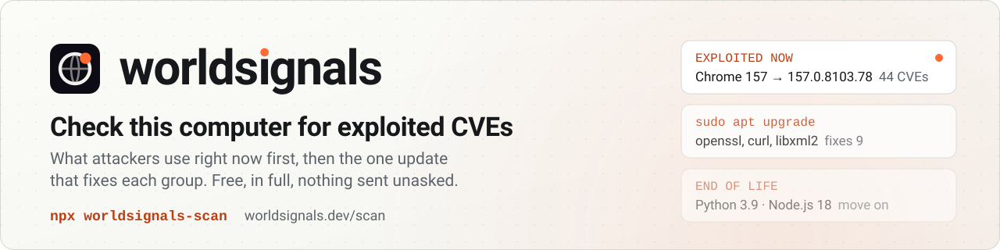

<p align="center">
  <a href="https://worldsignals.dev/scan">
    <picture>
      <source media="(prefers-color-scheme: dark)" srcset="https://raw.githubusercontent.com/Yumankind/worldsignals-js/main/assets/scan-banner-dark.svg">
      <source media="(prefers-color-scheme: light)" srcset="https://raw.githubusercontent.com/Yumankind/worldsignals-js/main/assets/scan-banner-light.svg">
      
    </picture>
  </a>
</p>

<p align="center">
  <a href="https://www.npmjs.com/package/worldsignals-scan"></a>
  <a href="https://github.com/Yumankind/worldsignals-js/actions/workflows/test.yml"></a>
  
  
  <a href="https://github.com/Yumankind/worldsignals-js/blob/main/LICENSE"></a>
</p>

<p align="center">
  
</p>

**One command checks the computer you're on for known and actively exploited vulnerabilities.** It shows what
attackers are using right now first, then the one update that fixes each group, with the command or menu to use,
and the software that no longer gets security fixes. Everything is free and in full. Nothing is sent to us unless
you ask for alerts.

```sh
npx worldsignals-scan
```

Node 18 or later, no dependencies, no admin rights. It also runs over SSH, checking the machine it runs on:
`ssh server 'npx worldsignals-scan'`.

## What it checks

| System | What it reads | How it matches |
| --- | --- | --- |
| **Debian** 10–13, **Ubuntu** (LTS and interim releases) | every installed package (dpkg), by source package | the distribution's own advisories, so fixes it backported count as fixed |
| **Alpine** 3.x | every installed package (apk), by origin | Alpine's advisories |
| **Rocky Linux**, **AlmaLinux** 8 and later | every installed package (rpm), with its epoch | the distribution's own advisories |
| **macOS** | Homebrew formulae and casks; every app in `/Applications` | Homebrew and about 40 common apps (browsers, Zoom, Teams, VS Code, Docker, VPN and remote-access tools, Acrobat Reader, LibreOffice…) by version, with `--nvd` |
| **Any Linux** | snap and flatpak apps | the same app list, with `--nvd` |
| **Everywhere** | global **npm** and **pip** packages; with `--here`, the lockfiles in this folder (`package-lock.json`, `requirements.txt`, `Cargo.lock`, `poetry.lock`, `uv.lock`, `Gemfile.lock`, `composer.lock`) | the npm, PyPI, crates.io, RubyGems and Packagist advisories |
| **All of it** | | exploited in the wild (CISA's Known Exploited Vulnerabilities) first, and end-of-life releases (endoflife.date) of the OS and runtimes |

Other distributions (Fedora, Arch, openSUSE, RHEL itself) are read and listed, but their packages aren't matched
yet. Windows programs come next; on Windows today it checks npm, pip and lockfiles.

## What leaves your computer

| Goes to | What | When |
| --- | --- | --- |
| [OSV.dev](https://osv.dev) (Google) | ecosystem, package name and version | every scan; never paths, user names or host name |
| [endoflife.date](https://endoflife.date) | product names such as `nodejs` or `macos` | every scan |
| [CISA](https://www.cisa.gov/known-exploited-vulnerabilities-catalog) | nothing (the catalogue is downloaded whole, cached 12 hours) | every scan |
| [NVD](https://nvd.nist.gov) (NIST) | an app's product name and version | only with `--nvd` |
| **WorldSignals** | **nothing** | unless you turn on alerts (below), which shows every line first |

`--dry-run` prints every request and its exact body, and sends none. `--inventory` lists what is installed, with no
request at all.

## Options

```text
--report scan.md   every vulnerability with its score, fix and link, as Markdown
--json             the findings as one JSON object, for scripts and agents
--here             also check the lockfiles in this folder
--nvd              also check known desktop apps and Homebrew formulae against NVD
                   (sends their names and versions there; one app every 7 s without NVD_API_KEY)
--dry-run          show what would be sent, and where; send nothing
--inventory        only list what is installed
--unchecked        list what couldn't be checked
```

## Alerts when a new vulnerability hits a machine (optional)

Today's check is free and complete, and needs no account. To hear about the next CVE, enrol the machine. WorldSignals
keeps its list of names and versions, matches it against every new vulnerability, and tells you when one hits it,
or when one already there starts being exploited. Alerts come by email, Slack, Teams, webhook or MCP, and the
[console](https://worldsignals.dev/console/machines) shows every machine.

```sh
npx worldsignals-scan --alerts --token <token>   # shows every line it would send, then asks
npx worldsignals-scan --schedule daily           # keeps the list current: launchd, systemd or cron, Task Scheduler
npx worldsignals-scan --forget                   # deletes it at WorldSignals and stops the schedule
```

**Many machines, from the command line.** No web console is needed:

```sh
worldsignals-scan signup && worldsignals-scan upgrade                 # on the paying machine
worldsignals-scan machine token --uses 10 --expires 7d                # prints the line for each machine
WS_ENROL_TOKEN=wsm_… npx worldsignals-scan machine enrol --yes        # on each machine: by hand, MDM, GPO, Ansible
worldsignals-scan machines                                            # list them and the tokens still working
worldsignals-scan upgrade --machines 20                               # more than your plan includes
```

To add a single machine without a token, run `worldsignals-scan machine add` on it, then
`worldsignals-scan machine approve <code>` wherever your account is signed in.

Every request is signed with a key made on the machine, and the key never leaves it. A machine that stops reporting
is deleted, with everything it sent, after 30 days.

| Plan | Machines with alerts |
| --- | --- |
| Free | 1 |
| Developer | 5 included |
| Team | 50 included |
| Business | 250 included |
| Extra machines | €2 a machine a month on any paid plan, added only when you ask (`upgrade --machines N`) |

Plans and prices: [worldsignals.dev/#pricing](https://worldsignals.dev/#pricing).

## How it compares

[OSV-Scanner](https://github.com/google/osv-scanner), [Trivy](https://github.com/aquasecurity/trivy) and
[Grype](https://github.com/anchore/grype) are excellent and free, and better than this for source code, containers
and CI: use them there. worldsignals-scan is for the computers people work on:

- **Desktop apps included**, not just packages.
- **Exploited now, first:** a CVSS score alone doesn't say what attackers use.
- **End-of-life warnings** for the OS and runtimes.
- **Grouped by the update that fixes it,** in plain language, for someone without a security team.
- **Optional alerts** for every enrolled machine afterwards, managed from the command line.

## More

- The same scanner is part of the [`worldsignals`](https://www.npmjs.com/package/worldsignals) CLI, as `ws scan`.
- Page: [worldsignals.dev/scan](https://worldsignals.dev/scan). Source:
  [github.com/Yumankind/worldsignals-js](https://github.com/Yumankind/worldsignals-js) (`bin/scan.mjs`).
- Found a wrong match? [Open an issue](https://github.com/Yumankind/worldsignals-js/issues) with `--json` output
  (it holds names and versions only). Security problems: [SECURITY.md](https://github.com/Yumankind/worldsignals-js/blob/main/SECURITY.md).
- MIT licence. © Yumankind OÜ.
